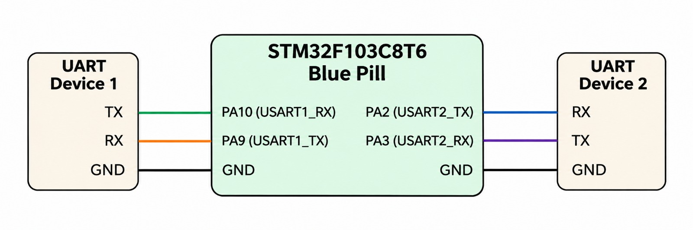

# EXPERIMENT DETAILS

**EXP:** CONTINUOUS ASSESSMENT 10

**NAME OF EXP:** UART Communication between STM32 and ESP8266 using AT Commands

**HARDWARE SETUP / PLATFORM:** STM32CubeMX + STM32CubeIDE / Keil MDK + STM32 Development Board + ESP8266 Wi-Fi Module

---

## TASK A – UART Communication using STM32 and ESP8266

### 1. Circuit Diagram

The experiment demonstrates UART-based serial communication between the STM32 microcontroller and ESP8266 Wi-Fi module using AT commands.

The STM32 communicates with the ESP8266 through USART1. The ESP8266 receives the AT command transmitted by the STM32 and sends its response back through the same UART interface.

USART2 is used to forward the received response from the ESP8266 to a computer through a serial terminal for monitoring.

**Hardware Components:**

- **Development Board:** STM32 Development Board
- **Wi-Fi Module:** ESP8266
- **UART Peripherals:** USART1 and USART2
- **Communication Protocol:** UART
- **Command Interface:** ESP8266 AT Commands
- **Serial Terminal:** Computer serial terminal

**Connections:**

*STM32 to ESP8266:*

- STM32 USART1 TX (PA9) → ESP8266 RX
- STM32 USART1 RX (PA10) → ESP8266 TX
- STM32 GND → ESP8266 GND

*STM32 to Serial Terminal:*

- STM32 USART2 TX (PA2) → USB-to-Serial Converter RX
- STM32 USART2 RX (PA3) → USB-to-Serial Converter TX
- STM32 GND → USB-to-Serial Converter GND

Ensure that the ESP8266 receives a suitable 3.3V power supply and that UART logic levels are compatible.

**UART Configuration:**

| Parameter | USART1 | USART2 |
|---|---|---|
| Baud Rate | 115200 | 115200 |
| Word Length | 8 Bits | 8 Bits |
| Stop Bits | 1 | 1 |
| Parity | None | None |
| Mode | Transmitter and Receiver | Transmitter and Receiver |

### 2. Core Logic / Pseudocode / Code Base

**Working Principle:**

The experiment demonstrates serial communication between the STM32 microcontroller and ESP8266 using AT commands.

Initially, the STM32 initializes the HAL library, configures the system clock, and initializes the GPIO and UART peripherals.

USART1 is configured for communication with the ESP8266, while USART2 is configured for communication with the computer's serial terminal.

After initializing both UART peripherals, the STM32 transmits the AT command `AT\r\n` to the ESP8266 through USART1.

The ESP8266 processes the received AT command and transmits its response through USART1.

The STM32 continuously receives the response one byte at a time using `HAL_UART_Receive()`.

Each received byte is immediately forwarded to the computer through USART2 using `HAL_UART_Transmit()`.

The received response can be monitored using a serial terminal configured with a baud rate of 115200.

**Pseudocode:**

1. Initialize the HAL library.
2. Configure the system clock.
3. Initialize GPIO peripherals.
4. Initialize USART1 with a baud rate of 115200.
5. Initialize USART2 with a baud rate of 115200.
6. Define the AT command `AT\r\n`.
7. Transmit the AT command to ESP8266 through USART1.
8. Declare a variable to store the received byte.
9. Enter the infinite loop.
10. Receive one byte of data from ESP8266 through USART1.
11. Transmit the received byte through USART2.
12. Display the ESP8266 response on the serial terminal.
13. Repeat the receiving and forwarding process continuously.

**Code Base:**

The UART communication operations are performed using the following STM32 HAL library functions:

- `HAL_Init()` – Initializes the HAL library.
- `SystemClock_Config()` – Configures the system clock.
- `MX_GPIO_Init()` – Initializes the GPIO peripherals.
- `MX_USART1_UART_Init()` – Initializes USART1 for communication with ESP8266.
- `MX_USART2_UART_Init()` – Initializes USART2 for serial terminal communication.
- `HAL_UART_Transmit()` – Transmits data through the selected UART peripheral.
- `HAL_UART_Receive()` – Receives data through the selected UART peripheral.

**Important Variables and Structures:**

- `huart1` – UART handle used for communication with ESP8266.
- `huart2` – UART handle used for communication with the serial terminal.
- `cmd` – Stores the AT command string transmitted to ESP8266.
- `rx` – Stores one byte of data received from ESP8266.

### 3. Inference

The STM32 microcontroller communicates with the ESP8266 Wi-Fi module through USART1 using UART communication.

The STM32 transmits the AT command `AT\r\n` to the ESP8266 and receives its response through the same UART interface.

The received response is forwarded to the computer through USART2 and can be monitored using a serial terminal.

This experiment demonstrates UART initialization, serial data transmission, byte-wise reception, and communication between an STM32 microcontroller and an ESP8266 Wi-Fi module using AT commands.
